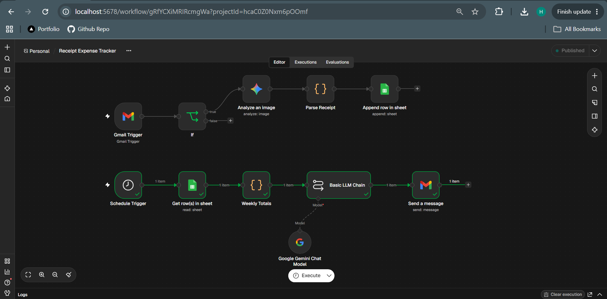
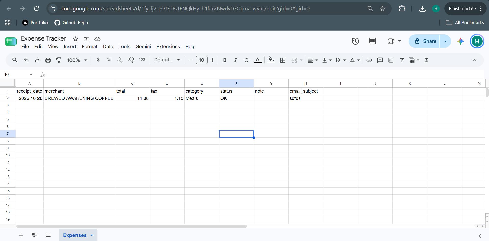
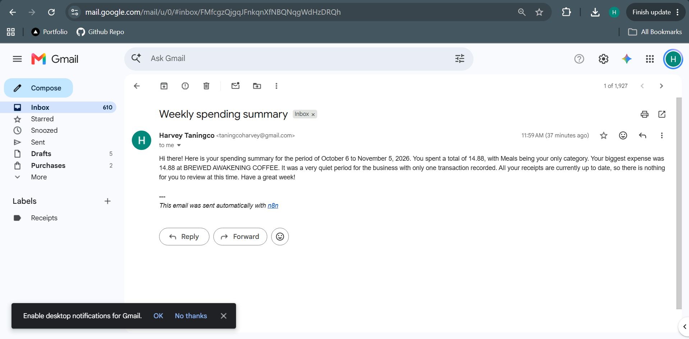

# Receipt Expense Tracker (n8n + Gemini Vision)

Email a receipt photo or PDF to a dedicated address and it gets read by AI, validated, and logged to Google Sheets. Every Monday morning, a short spending summary lands in your inbox.

Built with **n8n**, **Gmail**, **Google Gemini (vision)**, and **Google Sheets**.

> All receipts in `sample-data/` are fake and made up for testing.

---

## What it does

1. **Intake:** a Gmail Trigger watches the `Receipts` label for new emails.
2. **Filter:** emails with no attachment (newsletters, replies) are skipped.
3. **Read:** Gemini looks at the receipt and returns merchant, date, total, tax, and category as JSON.
4. **Validate:** a Code node checks the JSON. Anything unreadable is flagged `NEEDS REVIEW` instead of logging bad numbers.
5. **Log:** the row is appended to the `Expenses` tab in Google Sheets.
6. **Weekly summary:** a schedule trigger totals the last 7 days by category, Gemini writes a short plain-text summary, and Gmail sends it.

## Workflow overview

```
Lane 1: Receipt intake
Gmail Trigger -> IF (has attachment) -> Gemini (Analyze Image) -> Code (Parse Receipt) -> Google Sheets (Append Row)

Lane 2: Weekly summary
Schedule Trigger (Mon 8 AM) -> Google Sheets (Get rows) -> Code (Weekly Totals) -> Basic LLM Chain (Gemini) -> Gmail (Send)
```

## Project structure

```
receipt-expense-tracker/
├── README.md
├── workflows/
│   └── receipt-expense-tracker.json     # exported n8n workflow (credentials removed)
├── sample-data/
│   ├── receipt-1-coffee.png
│   ├── receipt-2-hardware.jpg           # rotated, slightly blurry
│   ├── receipt-3-restaurant.png         # includes tip
│   ├── receipt-4-fuel.png               # 2-digit year date
│   └── receipt-5-office-supply.pdf      # PDF (stretch)
└── screenshots/
    ├── 1-workflow-canvas.png
    ├── 2-expenses-sheet.png
    ├── 3-needs-review-test.png
    └── 4-weekly-summary-email.png
```

## Google Sheet layout

Tab: `Expenses`

| receipt_date | merchant | total | tax | category | status | note | email_subject |
|---|---|---|---|---|---|---|---|

- `status` is `OK` or `NEEDS REVIEW`
- `note` explains why a row needs review (e.g. `total not readable`)
- `category` is one of: Meals, Office Supplies, Fuel/Transport, Utilities, Software, Marketing, Other

## Test receipts and expected results

Each receipt uses a different date format on purpose, to test the AI.

| File | Merchant | Date | Total | Tax | Category |
|---|---|---|---|---|---|
| receipt-1-coffee | Brewed Awakening Coffee | 2026-10-28 | 14.88 | 1.13 | Meals |
| receipt-2-hardware | Lone Star Hardware | 2026-10-30 | 59.28 | 4.52 | Office Supplies / Other |
| receipt-3-restaurant | Rio Grande Grill | 2026-11-01 | 64.13 | 4.13 | Meals |
| receipt-4-fuel | Quick Fuel #218 | 2026-11-02 | 38.88 | 0.16 | Fuel/Transport |
| receipt-5-office-supply (PDF) | Metro Office Supply | 2026-11-03 | 130.16 | 9.92 | Office Supplies |

The four image receipts total **177.17**, which is what the weekly summary should report when run against them.

## Results

_Fill in after testing._

| Receipt | Matched expected? | Notes |
|---|---|---|
| 1 coffee | TBD | |
| 2 hardware (rotated, blurry) | TBD | |
| 3 restaurant | TBD | |
| 4 fuel (2-digit year) | TBD | |
| Non-receipt photo | TBD | Should log `NEEDS REVIEW` |
| 5 office supply (PDF) | TBD | Stretch |

## Screenshots

_Add once captured._





## Setup

1. Create a Google Sheet `Expense Tracker` with an `Expenses` tab and the headers above.
2. In Gmail, create a label `Receipts` and a filter: `To: yourname+receipts@gmail.com` -> apply label `Receipts`.
3. In n8n, import `workflows/receipt-expense-tracker.json`.
4. Connect credentials: Gmail (OAuth2), Google Sheets (OAuth2), Google Gemini (API key).
5. Point the Sheets nodes at your `Expense Tracker` document.
6. In the Gmail Trigger, set Simplify off and Download Attachments on (prefix `attachment_`).
7. Publish the workflow.

## Design decisions

- **Null over guessing:** the prompt tells Gemini to return `null` for anything unclear, so the validator can flag it rather than log a wrong number.
- **Validation before logging:** unreadable receipts become `NEEDS REVIEW` rows, so nothing silently bad enters the sheet.
- **Math in code, words in AI:** totals are calculated in a Code node. Gemini only writes the summary text and is told not to invent numbers.
- **Label-based intake:** a `+receipts` alias plus a Gmail label gives a dedicated receipt inbox without a second account.

## Known limitations

- Free-tier Gemini rate limits can return 429 errors; retry after a minute.
- Re-labeling old emails causes them to be processed again (duplicate rows).
- Blurry or heavily rotated photos may need prompt tuning.

## Skills demonstrated

Email triggers, attachment handling, AI vision extraction, JSON validation, scheduled workflows, and AI-written summaries.
